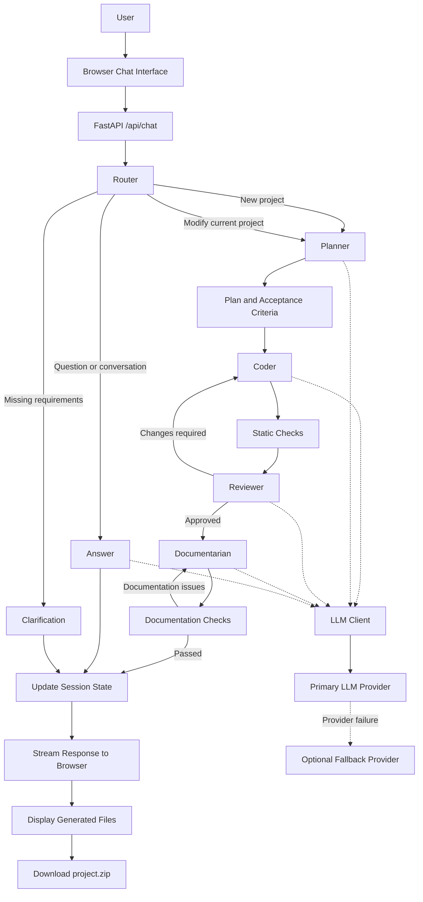

# Ticket2Code AI Crew

Ticket2Code AI Crew transforms natural-language software requests into reviewed software projects. Its web interface lets users describe what they need, follow the progress of a multi-agent workflow, inspect generated files, and download the complete project as a ZIP archive.

You can run it locally using Ollama or a hosted language model, or deploy the web application to make it accessible through a public URL.

**Links**
- **Live demo:** [Try the deployed application](https://ticket2code-ai-crew.onrender.com/)
- **Source code:** [GitHub repository](https://github.com/diegoquezadaco/ticket2code-ai-crew)

## Overview

The application uses a Router and specialized agents to process software requests. The workflow can plan, implement, validate, review, and document a project before returning the results to the user.

The interface also supports follow-up requests, allowing users to ask questions about the current delivery or request changes without manually managing session identifiers.

## How the Agent Workflow Works

The application implements a multi-agent workflow using its own orchestration logic. The term *AI Crew* refers to these collaborating roles; it does not imply that the project uses the CrewAI Python framework.



### Agent responsibilities

1. **Router** — Classifies the user's message and determines whether it requires a new implementation, a modification, an answer, ordinary conversation, or clarification.
2. **Planner** — Converts the request into a structured plan and acceptance criteria.
3. **Coder** — Generates project files and implements the planned changes. During retries, it can use targeted edits for existing files.
4. **Static Checks** — Validate generated Python syntax and JSON before the implementation is reviewed.
5. **Reviewer** — Evaluates the implementation against the plan. If problems are found, the workflow can return to the Coder for another attempt.
6. **Documentarian** — Generates the project's README after the implementation is approved.
7. **Documentation Checks** — Verify the generated documentation and check for expected setup, testing, and execution instructions.

The workflow has a configurable retry limit through `MAX_RETRIES`. Implementation and documentation checks are separate stages.

### Conversation handling

Users do not need to provide a session ID when interacting through the chat interface. The application manages conversation state, while the Router interprets each message to determine the appropriate action.

For example, after generating a project, a user can write:

> Add input validation to the signup form.

The application can interpret this as a modification to the current delivery rather than treating it as an unrelated request.

Questions about an existing delivery can also be answered using the current session context without necessarily starting another implementation run.

## Example Chat Requests

You can describe your requirements in **English or Spanish**. The application can respond in either language; specify your preferred language in the request when necessary.

The following examples illustrate useful ways to interact with the application.

### 1. Create a new project

**English**
```text
Build a Python CLI application to manage personal expenses.
Users should be able to add expenses, list them by category,
and calculate monthly totals. Include input validation and tests.
```

**Español**
```text
Crea una aplicación de línea de comandos en Python para gestionar
gastos personales. Debe permitir agregar gastos, filtrarlos por
categoría y calcular totales mensuales. Incluye validaciones y pruebas.
```

### 2. Request a specific implementation

**English**
```text
Create a REST API using FastAPI with endpoints to create, retrieve,
update, and delete tasks. Use Pydantic models for validation and
include instructions for running the application.
```

**Español**
```text
Crea una API REST con FastAPI para crear, consultar, actualizar
y eliminar tareas. Utiliza modelos de Pydantic para validar los datos
e incluye instrucciones para ejecutar la aplicación.
```

### 3. Modify the current project

After a project has been generated, describe the change you want.

**English**
```text
Modify the current project to store tasks in SQLite instead of
keeping them in memory. Preserve the existing API endpoints and
update the tests accordingly.
```

**Español**
```text
Modifica el proyecto actual para guardar las tareas en SQLite
en lugar de mantenerlas en memoria. Conserva los endpoints existentes
y actualiza las pruebas correspondientes.
```

### 4. Debug an implementation

**English**
```text
Review the current implementation for potential bugs.
Focus on invalid inputs, missing error handling, and edge cases.
Fix the issues you find and update the tests.
```

**Español**
```text
Revisa la implementación actual en busca de errores.
Concéntrate en entradas inválidas, manejo de excepciones y casos límite.
Corrige los problemas encontrados y actualiza las pruebas.
```

### 5. Improve code quality

**English**
```text
Refactor the current project to improve readability and maintainability.
Avoid unnecessary dependencies, preserve the existing behavior,
and add tests for any modified functionality.
```

**Español**
```text
Refactoriza el proyecto actual para mejorar su legibilidad y mantenimiento.
Evita dependencias innecesarias, conserva el comportamiento existente
y agrega pruebas para la funcionalidad modificada.
```

### 6. Ask questions about the generated project

**English**
```text
Explain the purpose of each generated file and describe how
the application components interact.
```

**Español**
```text
Explica la función de cada archivo generado y describe cómo
interactúan los componentes de la aplicación.
```

### 7. Request a particular response language

```text
Please explain the implementation and setup instructions in Spanish.
```

Or:

```text
Por favor, explica la implementación y las instrucciones de instalación en inglés.
```

**Tip:** Specific requirements produce more useful results. Mention the expected behavior, technical constraints, validation rules, and tests whenever they matter.

## Requirements

- Python 3.10 or later.
- Git.
- An LLM provider accessible through an OpenAI-compatible API.
- For local inference, [Ollama](https://ollama.com/) and a compatible model downloaded to the machine running Ollama.

You can use a hosted provider as the primary LLM, use Ollama as the primary provider, or configure Ollama as an optional fallback.

## Running Locally

There are two common local configurations:

- **Hosted LLM:** The application runs on your computer, but model requests go to a hosted provider.
- **Local Ollama:** Both the application and the language model run on your computer.

### 1. Clone the repository

```bash
git clone https://github.com/diegoquezadaco/ticket2code-ai-crew.git
cd ticket2code-ai-crew
```

### 2. Create a Python environment

```bash
python3 -m venv .venv
source .venv/bin/activate
python -m pip install -r requirements-dev.txt
```

On Windows PowerShell, activate the environment with:

```powershell
.venv\Scripts\Activate.ps1
```

### 3. Configure environment variables

Create a local environment file:

```bash
cp .env.example .env
```

Edit `.env` according to the provider you want to use. Do not commit API keys or other secrets to the repository.

### Option A: Use a hosted LLM provider

Configure the primary provider using the values required by your provider. For example, the default configuration targets Groq's OpenAI-compatible API.

```dotenv
LLM_API_KEY=your_provider_api_key
LLM_BASE_URL=https://api.groq.com/openai/v1
LLM_MODEL=openai/gpt-oss-20b
```

Replace the API key and model with valid values for your account and provider.

The application also supports optional model overrides for individual agent roles.

### Option B: Use Ollama locally

Install Ollama and download a model. For example:

```bash
ollama pull qwen2.5-coder:7b
```

Check that the model is available:

```bash
ollama list
```

Ollama normally exposes its local API on port `11434`. If the service is not already running, start it in a separate terminal:

```bash
ollama serve
```

Configure `.env`:

```dotenv
LLM_API_KEY=ollama
LLM_BASE_URL=http://localhost:11434/v1
LLM_MODEL=qwen2.5-coder:7b
```

The `ollama` API key value is a placeholder for this configuration; it is not a real secret.

Make sure `LLM_MODEL` matches the name of a model installed in Ollama. Leave role-specific model overrides empty if you want the agents to use `LLM_MODEL`.

### 4. Start the web application

From the repository root, with the Python environment activated, run:

```bash
uvicorn app.main:app --reload
```

Open the following address in your browser:

**http://127.0.0.1:8000**

Submit a request in the chat interface, follow the agent activity, inspect the generated files, and download the completed project using the ZIP download option.

For a local development server, `--reload` automatically restarts the application when relevant source files change.

## Deploying the Web Application

Local execution and public deployment have different networking requirements. In particular, a deployed web application cannot use `localhost` to reach Ollama running on your personal computer.

The following steps describe the general deployment process. The repository does not include a hosting-provider-specific deployment manifest, so the exact dashboard steps will depend on your chosen platform.

### 1. Choose a hosting platform

Provision a Python web service and connect it to the repository:

[GitHub repository](https://github.com/diegoquezadaco/ticket2code-ai-crew)

The service must be able to install the project's Python dependencies and run the FastAPI application.

### 2. Install dependencies

Use the runtime dependencies for the deployed application:

```bash
python -m pip install -r requirements.txt
```

Use `requirements-dev.txt` when development and test dependencies are also needed.

### 3. Configure the start command

Configure the hosting platform to start the application with a command such as:

```bash
uvicorn app.main:app --host 0.0.0.0 --port $PORT
```

`$PORT` is commonly supplied by the hosting platform. If your provider uses a different mechanism, adapt the command accordingly.

### 4. Configure the environment variables

Add the required variables in the hosting platform's environment configuration:

```dotenv
LLM_API_KEY=your_provider_api_key
LLM_BASE_URL=https://api.groq.com/openai/v1
LLM_MODEL=openai/gpt-oss-20b
```

Configure any optional role-specific model overrides or fallback provider settings you need.

**Keep credentials in the hosting platform's secret or environment-variable settings.** Do not hardcode real API keys in source files or commit them to Git.

### 5. Verify the deployment

After deployment:

1. Open the public URL assigned to the service.
2. Confirm that the chat interface loads.
3. Submit a small software request.
4. Verify that agent activity is streamed to the browser.
5. Check that generated files are displayed.
6. Test the project ZIP download.
7. Review the hosting logs if an LLM request or generation stage fails.

The application exposes a health endpoint at `/health`, which can be used for basic health checks.

## Using Ollama with a Deployed Application

There is an important distinction between **deploying the web application** and **hosting the language model**.

If the web application runs on a remote hosting platform while Ollama runs on your personal computer, this configuration will not work:

```dotenv
LLM_BASE_URL=http://localhost:11434/v1
```

In the deployed environment, `localhost` refers to the application server, not your personal computer.

There are two main approaches.

### Option 1: Host Ollama somewhere reachable by the application

Run Ollama on a server or in an environment that the deployed application can reach over the network.

Set `LLM_BASE_URL` to the Ollama server's reachable address, including the OpenAI-compatible API path:

```dotenv
LLM_API_KEY=ollama
LLM_BASE_URL=https://your-ollama-host.example/v1
LLM_MODEL=qwen2.5-coder:7b
```

The hostname above is an example placeholder. Replace it with the actual address of your Ollama service.

### Option 2: Expose local Ollama through ngrok

For a demonstration or temporary setup, you can use [ngrok](https://ngrok.com/) to create a public tunnel to the machine running Ollama.

This approach lets a remotely deployed web application send model requests to your local Ollama instance, provided the tunnel and network access are configured correctly.

**Step 1 — Start Ollama on your computer**

Ensure the model is installed and Ollama is running:

```bash
ollama list
```

If necessary, start the service:

```bash
ollama serve
```

**Step 2 — Start an ngrok tunnel**

Install and configure ngrok according to its official documentation. Then expose the Ollama API port:

```bash
ngrok http 11434
```

ngrok will provide a public forwarding address. Use the actual HTTPS address displayed by your ngrok session; do not copy an example address from this README.

**Step 3 — Change the environment variable**

Suppose ngrok provides a forwarding address such as `https://your-assigned-domain.ngrok-free.app`. Update the deployed application's environment variables:

```dotenv
LLM_API_KEY=ollama
LLM_BASE_URL=https://your-assigned-domain.ngrok-free.app/v1
LLM_MODEL=qwen2.5-coder:7b
```

The domain is illustrative. Replace it with the address assigned to your tunnel.

The key change is:

```text
http://localhost:11434/v1
```

becomes:

```text
https://YOUR_NGROK_DOMAIN/v1
```

If Ollama is configured as the **fallback** rather than the primary provider, change `FALLBACK_BASE_URL` instead of `LLM_BASE_URL`:

```dotenv
FALLBACK_API_KEY=ollama
FALLBACK_BASE_URL=https://your-assigned-domain.ngrok-free.app/v1
FALLBACK_MODEL=qwen2.5-coder:7b
```

Use the corresponding variable for the provider role you are configuring.

**Step 4 — Redeploy or restart the web application**

Save the environment-variable changes and restart or redeploy the service if required by your hosting platform. Submit a test request to verify that the application can reach the model.

**Security considerations**

A public tunnel exposes a service on your local machine to external network traffic. Do not expose Ollama publicly without considering access controls and the risks of unauthorized model usage. Use appropriate authentication or access restrictions where supported, keep the tunnel active only when needed, and do not treat an ngrok URL as a security mechanism by itself.

This setup also depends on your computer remaining powered on, connected to the internet, and running Ollama and ngrok. It is suitable for experimentation, but a dedicated, secured model host is generally more appropriate for a persistent deployment.

## Environment Variables

The application loads settings from `.env` and the process environment. Values supplied by the hosting environment can override local configuration.

| Variable | Purpose | Default |
|---|---|---|
| `LLM_API_KEY` | API key for the primary LLM provider. Use `ollama` for the local Ollama configuration. | Empty |
| `LLM_BASE_URL` | Base URL for the primary OpenAI-compatible API. | `https://api.groq.com/openai/v1` |
| `LLM_MODEL` | Default model used by agent roles without an override. | `openai/gpt-oss-20b` |
| `PLANNER_MODEL` | Optional model override for the Planner. | `LLM_MODEL` |
| `CODER_MODEL` | Optional model override for the Coder. | `LLM_MODEL` |
| `REVIEWER_MODEL` | Optional model override for the Reviewer. | `LLM_MODEL` |
| `DOCUMENTARIAN_MODEL` | Optional model override for the Documentarian. | `LLM_MODEL` |
| `FALLBACK_API_KEY` | Optional fallback provider API key. | Empty |
| `FALLBACK_BASE_URL` | Base URL for the optional fallback provider. | Disabled |
| `FALLBACK_MODEL` | Model used by the fallback provider. The fallback requires both its URL and model to be configured. | Disabled |
| `MAX_RETRIES` | Maximum number of additional implementation retries after the first attempt. | `5` |
| `LLM_TIMEOUT_SECONDS` | Timeout for primary-provider requests. | `60` |
| `FALLBACK_TIMEOUT_SECONDS` | Timeout for fallback-provider requests. | `380` |
| `MAX_SESSIONS` | Maximum number of in-memory sessions retained by the process. | `400` |
| `GROQ_TPM_BUDGET` | Estimated tokens-per-minute budget used for Groq request protection. | `5900` |
| `GROQ_WAIT_SECONDS` | Maximum wait for Groq capacity before the application reports a budget-related error. | `5` |
| `GROQ_COOLDOWN_SECONDS` | Cooldown after a Groq rate-limit response. | `60` |

The Groq token budget uses an application-side estimate, not an exact count of the provider's tokenizer. Actual provider limits may differ by model and account.

## HTTP Endpoints

| Method | Path | Description |
|---|---|---|
| `GET` | `/` | Serves the web chat interface. |
| `GET` | `/health` | Reports application health and whether the primary LLM client is configured. |
| `POST` | `/api/chat` | Receives chat input and streams newline-delimited JSON events, including activity and final or error events. |
| `GET` | `/api/sessions/{session_id}/trace` | Returns trace entries recorded for a session. |
| `GET` | `/api/sessions/{session_id}/download` | Downloads the latest generated files for a session as `project.zip`. |

The chat interface manages the conversation state for the user. The session-specific trace and download endpoints use a session identifier internally; that identifier is not something the user needs to invent or include in an ordinary chat message.

**Trace limitation:** The trace endpoint is implemented, but the current pipeline does not persist turn events into `Session.runs`. Use the live chat stream to inspect agent activity.

## Running Tests

The test suite uses scripted fake model responses, so it can run without making requests to a hosted provider or requiring Ollama.

With the virtual environment activated:

```bash
python -m pytest -q
```

The tests cover API behavior, streaming events, ZIP archive contents, pipeline outcomes, generated documentation, and LLM request logging.

Test results depend on the current code and test fixtures. Run the suite in your environment to verify the latest state before relying on a particular pass/fail count.

## Project Structure

| Path | Purpose |
|---|---|
| `app/main.py` | FastAPI application, chat streaming, health and trace endpoints, and ZIP downloads. |
| `app/pipeline.py` | Coordinates routing, planning, code generation, validation, review, documentation, and session updates. |
| `app/agents.py` | Agent instructions, response parsing, file handling, static checks, and documentation checks. |
| `app/llm.py` | OpenAI-compatible model clients, fallback handling, retries, Groq rate-limit protection, and request logging. |
| `app/config.py` | Loads application and provider settings from environment variables and `.env`. |
| `app/session.py` | Stores in-memory session state and manages bounded session storage. |
| `static/index.html` | Chat interface, streamed activity display, generated-file rendering, and ZIP download link. |
| `tests/` | API, pipeline, and LLM tests. |
| `.env.example` | Example environment configuration. |
| `requirements.txt` | Runtime dependencies. |
| `requirements-dev.txt` | Runtime dependencies plus development and test packages. |

## Current Limitations

- **In-memory state:** Sessions, conversation context, generated files, and request coordination are held in process memory. Restarting the process loses this state.
- **Single-process deployment:** Multiple workers or replicas do not share session or rate-limit state. Use a single worker for the current design unless session storage and shared coordination are implemented.
- **Ollama availability:** A deployed application can use Ollama only if the model service is reachable from the application server. A local `localhost` URL is not sufficient for a remote deployment.
- **Provider limits:** Hosted model providers may enforce request and token limits. Configure models and provider settings according to your account and the demands of the workflow.
- **No provider-specific deployment configuration:** The repository does not include a complete hosting-platform manifest or production infrastructure setup. Configure the service, secrets, networking, and health checks for your selected platform.

## License

See the [`LICENSE`](https://github.com/diegoquezadaco/ticket2code-ai-crew/blob/main/LICENSE) file in the repository.
